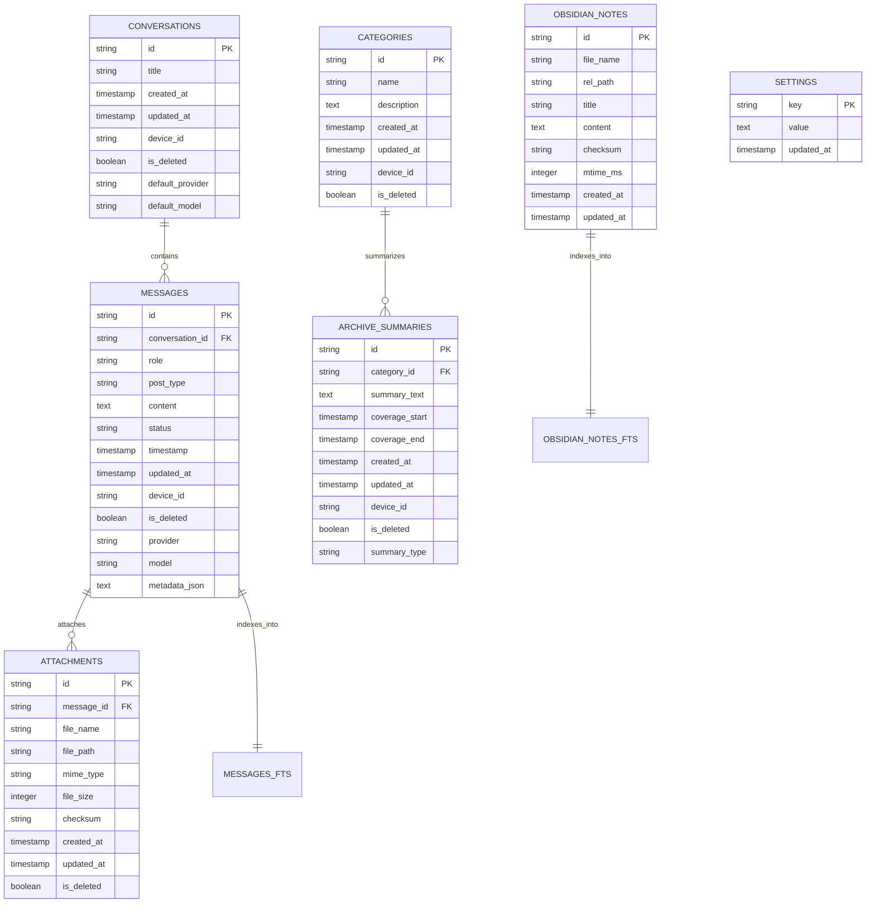
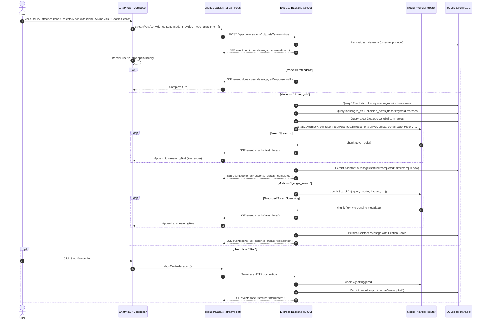
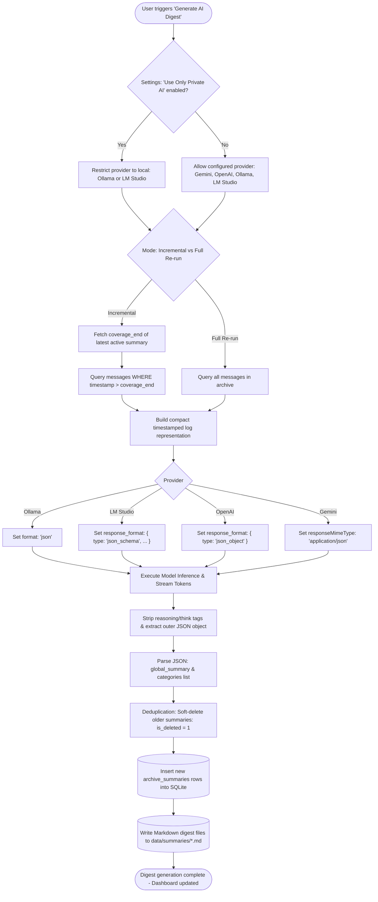
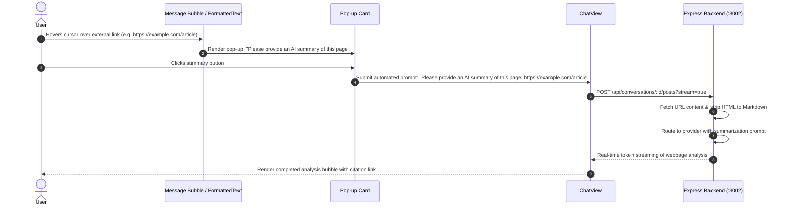

# Personal AI Archive - Architecture & System Specifications

This document outlines the complete system architecture, component breakdown, key technical processes, data design, and operational specifications for the **Personal AI Archive** application.

---

## 1. System Outline & Component Hierarchy

The application is structured into four primary layers designed for high modularity, offline-first reliability, cost control, strict privacy isolation, and multi-provider AI communication.

```
Personal AI Archive
├── 1. Presentation Layer (Frontend UI - React 19 + Vite @ Port 5173)
│   ├── Chat Workspace (ChatView.jsx)
│   │   ├── Multi-Mode Triple Action Composer (Standard Post, Archive AI Analysis, Google Search AI)
│   │   ├── Real-time SSE Token Streaming with live optimistic message updates
│   │   ├── Instant Stop Generation button with server-side AbortController signal
│   │   ├── Multimodal Attachment Bar (Image preview, upload, drag-and-drop)
│   │   └── Dynamic Source Cards & Citations (Domain badges, external link cards)
│   ├── Obsidian Notes Explorer (ObsidianNotesView.jsx)
│   │   ├── Live Vault Sync Status indicator & manual "Sync Vault Now" trigger
│   │   ├── Debounced Full-Text Search across imported vault notes (obsidian_notes_fts)
│   │   ├── Note Inspector (Metadata, path, timestamps, preview)
│   │   └── Context Insertion Actions (Insert into composer, start dedicated chat with note)
│   ├── Archive Explorer (ArchiveView.jsx)
│   │   ├── Chronological conversation timeline with provider/model filtering
│   │   ├── Full-Text Search across historical turns (messages_fts)
│   │   └── Message inspector & conversation deletion
│   ├── Intelligence Dashboard (SummaryView.jsx)
│   │   ├── Topic categorization cards & recommendation badges
│   │   ├── Global Executive Archive Digest viewer
│   │   └── Summarization Trigger (Incremental vs. Full Re-run with private AI enforcement)
│   ├── Settings Modal (SettingsModal.jsx)
│   │   ├── Provider API Keys (Gemini, OpenAI) with secure masking (••••<last4>)
│   │   ├── Local Provider Base URLs (Ollama default :11434, LM Studio default :1234/v1)
│   │   ├── Obsidian Vault path configuration with debounced validation
│   │   └── Privacy Enforcement Toggle ("Use only private AI for summarization")
│   ├── Interactive Hyperlink Summarizer (FormattedText.jsx)
│   │   └── Hover pop-up tooltip: "Please provide an AI summary of this page"
│   └── Data Portability Hub
│       └── One-click streaming Obsidian Vault (.zip) export & complete JSON database backup
│
├── 2. Core Service Layer (Application Engine - Node.js Express @ Port 3002)
│   ├── Security & Host Binding
│   │   ├── Strict localhost isolation (bound exclusively to 127.0.0.1)
│   │   ├── Origin-restricted CORS middleware (localhost / 127.0.0.1 origins only)
│   │   └── API Key Masking Engine (GET /api/settings masks secrets; POST ignores masked values)
│   ├── Central Configuration Module (config.js)
│   │   ├── Unified model defaults, fallback model lists, and provider URL normalization
│   │   └── Conversation history token/turn budget management (12 turns / 4,000 chars)
│   ├── Model Provider Router (providers.js)
│   │   ├── Unified streaming interface (streamChat, analyzeArchiveKnowledge, googleSearchAI)
│   │   ├── Live System Date & Time Anchor injection into model system prompts
│   │   ├── Provider Health Probing with 10-minute memory cache for Gemini model list
│   │   ├── Robust chunk-buffered line parsing for Ollama NDJSON streams
│   │   └── LM Studio json_schema constraint support with fallback
│   ├── Two-Way Obsidian Vault Sync Engine (obsidianSync.js)
│   │   ├── Vault partition isolation: imports notes outside "AI Archive/"; exports to "AI Archive/"
│   │   ├── Incremental change detection via filesystem mtime and SHA-256 checksums
│   │   └── Transactional database upsert with automatic FTS5 trigger synchronization
│   ├── Summarization & Topic Extraction Pipeline (summarizer.js)
│   │   ├── Strict private AI enforcement (rejects cloud routing when enabled)
│   │   ├── Deduplication engine: upserts active summaries and soft-deletes superseded records
│   │   └── Dual persistence: writes both SQLite rows and Markdown notes on disk
│   └── Unified Post & Streaming API (index.js)
│       └── Server-Sent Events (SSE) streaming pipeline on /api/conversations/:id/posts
│
├── 3. Data & Storage Layer (Local Persistence & Security)
│   ├── SQLite Embedded Database (data/archive.db via better-sqlite3 with WAL mode)
│   ├── Versioned Migration Engine (PRAGMA user_version tracking migrations 1, 2, 3)
│   ├── Performance Indexes (messages(conv_id, ts), messages(ts), attachments(msg_id), etc.)
│   ├── External-Content FTS5 Virtual Tables (messages_fts and obsidian_notes_fts)
│   │   └── Automatic SQLite database triggers (ai, ad, au) on messages & obsidian_notes
│   ├── Local Summaries Vault (data/summaries/*.md generated digest notes with YAML frontmatter)
│   ├── Local Media Store (data/media/ for image attachments with Vite proxy integration)
│   └── Portable Backup Handler (Streaming dynamic Obsidian Vault .zip via archiver)
│
└── 4. AI Provider Integration Layer (Adapters)
    ├── Google Gemini Adapter (@google/genai SDK, gemini-3.8-flash, live web search grounding)
    ├── OpenAI Adapter (openai SDK, gpt-4o-mini, gpt-4o, o3-mini)
    ├── Ollama Adapter (Local offline REST API on default port 11434 with format: 'json')
    └── LM Studio Adapter (Local OpenAI-compatible API on default port 1234 with json_schema)
```

---

## 2. Storage, Synchronization & Data Schema Design

### Storage Architecture: SQLite with External-Content FTS5 + Local Blob Store
- **Single Source of Truth**: All structured data resides in a local `archive.db` using `better-sqlite3` with Write-Ahead Logging (`WAL`) enabled for fast concurrent reads and atomic writes.
- **Versioned Migrations**: Managed via `PRAGMA user_version`. Schema enhancements, indexes, and virtual tables run incrementally on startup.
- **External-Content Full-Text Search (FTS5)**:
  - `messages_fts` references `messages(rowid)` without duplicating text storage on disk.
  - `obsidian_notes_fts` references `obsidian_notes(rowid)` indexing `title`, `content`, and `rel_path`.
  - Database triggers (`AFTER INSERT`, `AFTER DELETE`, `AFTER UPDATE`) synchronize the FTS indexes automatically upon any table modification.
- **Local Blob Store**: Binary image uploads are written to `data/media/` and served by Express at `/media/`. The client dev server proxies `/media` directly to the backend.

### Two-Way Obsidian Vault Synchronization Architecture

The application synchronizes bi-directionally with a local Obsidian Vault while preserving strict boundary safety:

```
Obsidian Vault Root (<VaultPath>/)
├── Notes/               ──┐
├── Projects/              │  IMPORT DIRECTION (Vault -> DB)
├── Daily/                 │  - Scans markdown files OUTSIDE "AI Archive/"
└── Any_Other_Folder/    ──┘  - Skips unchanged files via mtime & SHA-256 checks
                              - Upserts into obsidian_notes & obsidian_notes_fts
                              - Never modified or deleted by the export process
├── AI Archive/          ──┐
│   ├── Conversations/     │  EXPORT DIRECTION (DB -> Vault)
│   └── Summaries/       ──┘  - Writes timestamped markdown exports with YAML frontmatter
                              - Ignored by the import scanner to prevent feedback loops
```

1. **Vault Partitioning & Boundary Isolation**:
   - Folders ignored during import: `AI Archive/`, `.obsidian`, `.trash`, `.git`, `attachments`, `node_modules`.
   - The export process writes **exclusively** to `<Vault>/AI Archive/`. It will **never** overwrite, rename, or touch user notes in other folders.
2. **Incremental High-Speed Sync**:
   - Compares disk file `mtime` with `mtime_ms` stored in SQLite. If unchanged, file reads and hashing are skipped entirely.
   - If `mtime` changed, computes the SHA-256 hash. If content matches, only the timestamp is updated.
   - All DB operations execute within a single atomic `db.transaction`.
3. **Triggered FTS Indexing**:
   - Because `obsidian_notes_fts` uses external content and SQLite triggers, note insertions and edits automatically update search rankings without manual application SQL statements.

---

### Data Schema Design



---

## 3. Key Processes & Execution Flows

### Process 1: Unified Multi-Mode Posting & Real-Time SSE Streaming

The unified posting flow merges standard messages, archive knowledge synthesis, and live web search into a single streaming endpoint (`/api/conversations/:id/posts?stream=true`).



#### Real-Time Temporal Anchoring
To prevent hallucinated or stale dates in local offline models (e.g., LM Studio templates with hardcoded dates), the server injects explicit temporal context:
1. **System Prompt**: `CURRENT SYSTEM DATE & TIME: ${nowIso} (${nowDateStr}, ${nowTimeStr})`
2. **Current Post Header**: `CURRENT USER POST [${nowIso}]:\n"""\n${userPost}\n"""`
3. **Multi-Turn History**: Each turn includes its timestamp: `${role} [${timestamp}]: ${content}`
4. **Retrieved Notes**: Notes include their modification time: `[Obsidian Note: "${title}"] (${rel_path}) [Updated: ${noteTime}]`

---

### Process 2: Two-Way Obsidian Vault Synchronization Flow

```mermaid
sequenceDiagram
    autonumber
    actor User as User / Auto-Sync
    participant UI as ObsidianNotesView / SettingsModal
    participant Server as Express /api/obsidian/sync
    participant Engine as obsidianSync.js
    participant Vault as Local Obsidian Vault (<VaultPath>)
    participant DB as SQLite & FTS5

    User->>UI: Click "Sync Vault Now" (or trigger background sync)
    UI->>Server: POST /api/obsidian/sync
    Server->>Engine: sync(vaultPath)

    rect rgb(20, 25, 45)
    Note over Engine,Vault: Step 1: Import Vault Notes (Vault -> DB)
    Engine->>Vault: Walk directory tree (ignoring "AI Archive/", ".obsidian", etc.)
    loop For each .md file
        Engine->>Engine: Compare disk mtime with DB mtime_ms
        alt mtime unchanged
            Engine->>Engine: Skip file read & SHA-256 calculation
        else mtime changed
            Engine->>Vault: Read file & calculate SHA-256 hash
            alt Hash matches
                Engine->>DB: Update mtime_ms only
            else Content changed / New file
                Engine->>DB: Upsert into obsidian_notes (within db.transaction)
                DB->>DB: Triggers obsidian_fts_au / ai update obsidian_notes_fts
            end
        end
    end
    Engine->>DB: Delete obsidian_notes rows no longer found on disk
    end

    rect rgb(35, 20, 45)
    Note over Engine,Vault: Step 2: Export Conversations & Summaries (DB -> Vault)
    Engine->>DB: Query active conversations & messages
    Engine->>Vault: Write <Vault>/AI Archive/Conversations/YYYY-MM-DD_Title_id.md
    Engine->>DB: Query active archive summaries & categories
    Engine->>Vault: Write <Vault>/AI Archive/Summaries/Category_Name.md & Global_Archive_Digest.md
    end

    Engine->>DB: Update 'obsidian_last_sync' setting
    Engine-->>Server: Return { success: true, totalVaultNotes, importedCount, updatedCount, deletedCount, exportedCount, durationMs }
    Server-->>UI: Render updated note badges & toast confirmation
```



---

### Process 3: AI Summarization, Categorization & Deduplication Pipeline



#### Privacy & Resilience Highlights
1. **Privacy Mode Enforcement**: If `only_private_ai_summarization` is true, attempts to route to Gemini or OpenAI throw a hard error.
2. **Deduplication**: Superseded summaries are soft-deleted (`is_deleted = 1`), preventing infinite row growth while preserving audit history.
3. **LM Studio Schema Handling**: Uses `json_schema` constraint compliant with LM Studio v0.3+, with automatic retry fallback if a model does not support grammar enforcement.
4. **Reasoning Extraction**: Cleanly strips internal `<think>...</think>` tags emitted by models like Qwen 2.5/3.6 or DeepSeek-R1.

---

### Process 4: Interactive Hyperlink Hover Summarization



---

### Process 5: JSON Archive Backup & Cross-Instance Restoration

The system provides zero-vendor-lockin data portability through comprehensive JSON export and two-way restoration, allowing complete historical archives to be seamlessly backed up or migrated to new or different instances.

```mermaid
sequenceDiagram
    autonumber
    actor User
    participant UI as Client UI (ArchiveView / SettingsModal)
    participant Modal as RestoreModal
    participant Server as Express Backend (:3002)
    participant DB as SQLite (archive.db)
    participant FTS as messages_fts (FTS5)

    Note over User,DB: Export Flow (Instance A)
    User->>UI: Clicks "JSON Backup"
    UI->>Server: GET /api/export/json
    Server->>DB: Query non-deleted conversations, messages, categories, summaries, attachments
    Server-->>User: Streams "personal_ai_archive_backup.json"

    Note over User,DB: Restore Flow (Instance B or Fresh Installation)
    User->>UI: Clicks "Restore Backup"
    UI->>Modal: Opens RestoreModal dialog
    User->>Modal: Selects/drops backup.json file
    Modal->>Server: POST /api/restore/preview (FormData)
    Server-->>Modal: Returns metadata, counts (conversations, messages, etc.), and sample titles
    Modal-->>User: Displays verified backup card & strategy options ("Merge" vs "Replace")
    User->>Modal: Chooses strategy & clicks "Restore Archive"
    Modal->>Server: POST /api/restore/json (FormData: file + mode)
    
    rect rgb(30, 41, 59)
        Note over Server,FTS: Atomic SQLite Transaction
        Server->>DB: BEGIN TRANSACTION
        alt Mode == 'replace'
            Server->>DB: Wipe existing messages, conversations, summaries, categories
        end
        Server->>DB: Upsert categories (with name conflict resolution)
        Server->>DB: Upsert conversations (retaining model/provider config)
        Server->>DB: Upsert messages (creating parent placeholders if needed)
        Server->>DB: Upsert attachments & summaries
        Server->>FTS: INSERT INTO messages_fts(messages_fts) VALUES ('rebuild')
        Server->>DB: COMMIT TRANSACTION
    end

    Server-->>Modal: Returns success response { success: true, mode, counts }
    Modal-->>UI: Dispatches onRestored callback
    UI->>Server: Refreshes conversations, summaries, categories, and FTS timeline
    UI-->>User: Displays success notification & opens restored threads
```



#### Restoration Strategy Specifications:
1. **Merge Mode (`mode: 'merge'`) (Default)**:
   - Safely merges incoming backup conversations, messages, topics, and summaries into the target database.
   - Primary key conflicts are upserted with updated contents without deleting or altering existing conversations unique to the current instance.
2. **Replace Mode (`mode: 'replace'`)**:
   - Cleanses existing conversation threads, messages, attachments, and summaries, creating an exact replica of the source instance backup.
   - Preserves local application configuration (API credentials, local Ollama/LM Studio endpoints, and Obsidian vault paths) in the `settings` table.
3. **Foreign Key Self-Healing**:
   - If an imported message references a conversation ID not present in the backup array, a placeholder conversation row is automatically provisioned to maintain strict relational constraints (`PRAGMA foreign_keys = ON`).
4. **Instant FTS5 Search Synchronization**:
   - Executes `INSERT INTO messages_fts(messages_fts) VALUES ('rebuild')` within the post-restore cycle, ensuring all imported content is immediately searchable across sub-millisecond full-text queries.

---

## 4. Current Implementation Status & Operational Runbook

### Active Port Architecture & Host Isolation
- **Backend API Server**: `http://127.0.0.1:3002`
  - Explicitly bound to `127.0.0.1` (localhost only).
  - CORS whitelist restricted to local browser clients (`http://localhost:5173`, `http://127.0.0.1:5173`, `http://localhost:3002`, `http://127.0.0.1:3002`).
- **Frontend Client (Vite Dev)**: `http://localhost:5173`
  - Proxies `/api`, `/summaries-files`, and `/media` to `http://127.0.0.1:3002`.
- **Local AI Endpoints**:
  - Ollama: `http://localhost:11434`
  - LM Studio: `http://localhost:1234/v1`

---

### Codebase Directory Structure

```
/Users/deangardiner/PersonalAIArchive
├── server/
│   ├── config.js          # Central configuration, model defaults, settings masking & limits
│   ├── db.js              # Versioned SQLite migrations (PRAGMA user_version), indexes, FTS5 triggers
│   ├── index.js           # Express app, 127.0.0.1 binding, restricted CORS, SSE streaming posts
│   ├── obsidianSync.js    # Two-way Obsidian Vault sync engine, mtime caching, atomic transactions
│   ├── providers.js       # Multi-model provider router (Gemini, OpenAI, Ollama, LM Studio)
│   └── summarizer.js      # Background topic categorization, digest generator & deduplication
│
├── client/
│   ├── src/
│   │   ├── api.js         # Unified client API wrapper & SSE stream reader (streamPost)
│   │   ├── App.jsx        # Root application state, view routing, active conversation management
│   │   ├── index.css      # Custom design tokens, dark mode, animations, source citation cards
│   │   ├── main.jsx       # React 19 entry point
│   │   └── components/
│   │       ├── ArchiveView.jsx       # Chronological conversation timeline & FTS search explorer
│   │       ├── ChatView.jsx          # Triple-action composer, streaming bubbles, media upload
│   │       ├── FormattedText.jsx     # Markdown renderer with hyperlink hover summarization pop-ups
│   │       ├── ObsidianNotesView.jsx # Vault explorer, live sync status, note inspector & insert
│   │       ├── SettingsModal.jsx     # Provider keys, base URLs, debounced vault path validation
│   │       ├── Sidebar.jsx           # Conversation thread navigation & view switching
│   │       └── SummaryView.jsx       # Global Executive Digest, category cards & digest trigger
│   ├── dist/              # Production build bundle served statically by Express in production
│   └── vite.config.js     # Dev server proxy configuration (/api, /summaries-files, /media)
│
├── electron/
│   ├── main.js            # Electron main process (lifecycle, window management, embedded Express)
│   └── preload.js         # Context bridge exposing desktop platform metadata
│
├── build/
│   ├── icon.png           # 1024x1024 application icon asset
│   └── icon.icns          # Multi-resolution native Apple icon format for dock & finder
│
├── dist-electron/         # Standalone desktop packaging output (DMG and .app bundles)
│
└── data/
    ├── archive.db         # SQLite database file (WAL mode, versioned migrations)
    ├── summaries/         # Local copy of generated Markdown digests (Global_Archive_Digest.md, etc.)
    └── media/             # Uploaded image attachments repository
```

---

### Operational Commands

```bash
# Start Backend API Server (Port 3002)
npm run server

# Start Frontend Dev Server (Port 5173 with Vite HMR)
npm run client

# Build Frontend for Production (Output to client/dist)
npm run build:client

# Run Standalone Desktop App in Local Electron Shell
npm run electron

# Package Native macOS Apple Silicon DMG (Outputs to dist-electron/)
npm run pack:mac

# Package Native macOS Intel DMG (Outputs to dist-electron/)
npm run pack:mac:intel

# Rebuild Native C++ Node Addons (better-sqlite3) for Electron
npm run rebuild:native

# Lint and Validate Client Code
npx oxlint client/src
```

---

### Verified Implementation Checklist

- [x] **Standalone macOS Desktop Application**: Native Apple Silicon (`arm64`) and Intel (`x64`) `.dmg` installers and `.app` bundles via Electron & electron-builder with embedded Express server and automatically rebuilt `better-sqlite3` native binaries.
- [x] **Zero-Terminal Installation**: Standard drag-to-Applications installer with automated routing to `~/Library/Application Support/Personal AI Archive/data/`.
- [x] **Unified Multi-Mode Posting**: Single composer supporting Standard Posts, Archive AI Analysis, and Google Search AI with live token streaming.
- [x] **Real-Time Temporal Context**: System prompt and user post headers automatically injected with live ISO timestamps and local calendar dates.
- [x] **Two-Way Obsidian Vault Sync**: Incremental sync with `mtime` and SHA-256 caching; full-text search across vault notes via `obsidian_notes_fts`.
- [x] **Multi-Provider AI Routing**: Google Gemini, OpenAI, Ollama, and LM Studio with active health probing and 10-minute model list caching.
- [x] **Security Hardening**: Express bound to `127.0.0.1`, restricted CORS origins, and masked API keys (`••••<last4>`) in settings responses.
- [x] **Database Optimization**: Versioned migrations (`PRAGMA user_version = 3`), B-Tree indexes, external-content FTS5 virtual tables, and automatic synchronization triggers.
- [x] **AI Summarizer & Topic Classifier**: Deduplicated upserts, private AI enforcement, LM Studio `json_schema` support, and dual SQLite/Markdown persistence.
- [x] **Google Search AI Grounding**: Real-time web search synthesis with interactive source citation cards.
- [x] **Interactive Hyperlink Hover Summaries**: On-demand web scraping and AI summaries via link hover tooltips.
- [x] **Data Portability**: Dynamic streaming Obsidian Vault (`.zip`) download, complete JSON database backup, and cross-instance restoration modal with safe merge or clean replace strategies.
